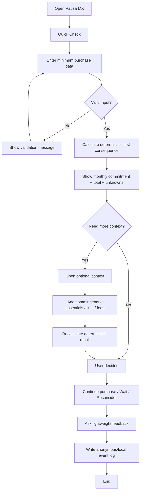
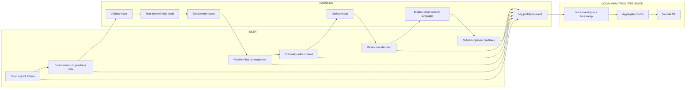

# WEEK 13 BUSINESS BENDING — PACKET

**Student:** Diego Gil  
**Role:** MONEY  
**Venture:** Pausa MX  
**Week theme:** REAL HUMANS — FIVE USERS WHO DON'T LOVE YOU  
**URL of record:** https://w10-pausa-mx.vercel.app  
**Repository of record:** https://github.com/diegoglbuilds/w10-pausa-mx  
**Week 13 working slice:** Quick Check + analytics/feedback loop  
**Product language:** Spanish (Mexico)  
**Documentation language:** English  

> **Evidence honesty:** The five Week 13 practice personas used to draft the Brain Bending brief were synthetic. They do not count as the course-required five real users. This build treats their findings as hypotheses to test, not as validated real-user evidence.

---

## 1. Problem in my own words

Pausa MX already helps a shopper evaluate an installment purchase before checkout. The Week 13 MONEY problem is not whether the arithmetic works; it is whether the product creates enough economic value to beat the user's free substitute.

The strongest threat is simple:

> **If a calculator, banking app, calendar, and memory can produce the same useful insight with similar effort, Pausa MX does not have a 10:1 case.**

The Week 13 slice therefore attacks **decision friction**.

The current product asks for enough financial context to produce a responsible result, but every extra field creates a cost at the exact moment when the user wants to finish a purchase. The product needs to surface one useful financial consequence quickly, then let the user add context only when it materially changes the answer.

The build must also add an analytics / feedback mechanism so real-user sessions can measure:

- whether users complete the check,
- how long the check takes,
- where they abandon,
- which optional fields they open,
- whether they understand the result,
- whether they say they would use it again,
- whether they report that the check changed a purchase decision.

The event log is for prototype learning only. It must not become hidden behavioral profiling.

---

## 2. Exact user

**Primary user:** Mexican shopper considering an installment / MSI / BNPL purchase and deciding whether the added monthly obligation fits before checkout.

### Working test profile

**Age range:** approximately 20–35  
**Behavior:** buys online or in-store, sometimes uses installments, MSI, BNPL, or credit.  
**Current workaround:** calculator, banking app, notes, memory, or no formal check.  
**Constraint:** does not want to build or maintain a complete budget before every purchase.  
**Trust requirement:** does not want to connect a bank account or expose full financial history just to run one purchase check.  
**Economic question:** “What does this purchase add to my commitments, and what important thing might I be forgetting?”

### MONEY lens

The user is not valuable evidence because they say “I like it.”

Useful evidence is:

- current workaround cost,
- completion time,
- data-entry friction,
- willingness to pay,
- whether the check reveals something they missed,
- whether they reconsider / delay / continue the purchase,
- whether they return for another purchase.

---

## 3. Success definition

**Before the module closes, the existing Pausa MX URL of record works with a Week 13 slice where a user can:**

1. Start a **Quick Check** with only the minimum purchase information:
   - purchase price,
   - installment count,
   - installment payment if known OR enough information to calculate it.
2. See an immediate **first consequence card**:
   - total committed cost,
   - added monthly payment,
   - clearly labeled unknowns.
3. Optionally open **“Agregar contexto”** to add:
   - current monthly installment commitments,
   - essential monthly expenses,
   - optional self-set monthly maximum,
   - fees / unknown fees.
4. See the result update transparently when context changes.
5. Understand that:
   - calculator math is deterministic,
   - unknowns remain unknown,
   - the app does not know all debts,
   - the app does not authorize or block a purchase.
6. Continue anyway if they choose.
7. Give lightweight feedback at the end:
   - “¿Te ayudó a decidir?”
   - Sí / Más o menos / No
   - optional short comment.
8. Generate a local prototype event log for:
   - `quick_check_started`
   - `quick_check_completed`
   - `context_opened`
   - `result_viewed`
   - `continue_anyway`
   - `decision_helpful_yes`
   - `decision_helpful_maybe`
   - `decision_helpful_no`
   - `feedback_submitted`
9. Show an **analytics/debug panel** only in demo mode with aggregate counts and no real PII.
10. Preserve the Week 10 buyer-control / shadow protections.
11. Pass tests and build.
12. Complete at least two Week 13 deploys, including one after a documented bug fix.

### Week 13 learning metric

Do **not** claim success because completion count rises.

The product hypothesis improves only if real users show some combination of:

- shorter time than their current workaround,
- less data-entry frustration,
- useful consequence discovered,
- changed / reconsidered purchase decision,
- repeat use / return intent,
- meaningful willingness to pay or another credible payer.

---

## 4. IMAGE-GENERATED mockup

**Target file:** `assets/mockup-pausa-mx-w13.png`

The Week 13 mockup should show four mobile states:

### Screen 1 — Quick Check

Header:
**Pausa MX**

Headline:
**“Antes de comprar, mira qué compromiso estás agregando.”**

Required fields:
- Precio
- Número de pagos
- Pago mensual (si ya lo conoces)

Primary CTA:
**“Ver consecuencia”**

Small disclosure:
**“No conectamos tu banco. Tú decides qué datos compartir.”**

### Screen 2 — First consequence

Card:

**“Esta compra agrega $___ al mes durante ___ meses.”**

Show:
- Total comprometido
- Pago mensual
- Dato faltante más importante

CTA:
**“Agregar contexto”**

Secondary:
**“Esto me basta”**

### Screen 3 — Add context

Optional fields:
- Otros pagos mensuales
- Gastos esenciales
- Tu máximo mensual
- Comisiones

Copy:
**“Estos datos son opcionales. Agregarlos puede cambiar el resultado.”**

### Screen 4 — Result + feedback

Result:
- Dentro de tu límite
- Revisa antes de comprar
- Espera

Always show:
**“Tú decides. Pausa MX no bloquea tu compra.”**

Feedback:
**“¿Te ayudó a decidir?”**
- Sí
- Más o menos
- No

Optional:
**“¿Qué faltó?”**

Small analytics disclosure:
**“En esta demo registramos eventos de uso sin datos personales para detectar dónde se atora el flujo.”**

---

## 5. Main feature flow — Mermaid

---

## 6. Swimlane — Mermaid

---

## 7. Benchmark line

**Best existing solution on Earth:** PocketGuard-style “safe to spend / leftover” logic reduces a complex financial picture to one actionable spending constraint.

**Mine differs / localizes by:** Pausa MX is a **purchase-specific, manual-first, Spanish-first pre-check for Mexico** that does not require a full budgeting habit or mandatory bank connection; Week 13 specifically tests whether it can deliver useful consequence visibility with less friction than calculator + banking app + memory.

### Benchmark truth

PocketGuard / Rocket Money / full-budgeting tools demonstrate that automation can reduce manual effort.

That creates a real competitive threat to Pausa MX:

> If users prefer linking accounts once over re-entering purchase context repeatedly, manual-first loses.

Manual-first is a trust hypothesis, not a doctrine.

---

## 8. Three-year long view

If this slice works, Pausa MX becomes a buyer-side decision layer used immediately before consequential purchases rather than a full budgeting app. It learns which minimum inputs produce useful decisions without requiring bank surveillance, then offers optional convenience layers such as confirmed screenshot extraction or user-controlled remembered constraints. The long-term moat is not arithmetic or “AI”; it is trusted consequence visibility at the decision moment while preserving buyer control and independence from retailer / lender incentives.

---

## 9. Scope cut — NOT building now

Not building:

- bank account connections,
- Open Banking aggregation,
- credit scoring,
- lender approvals,
- retailer recommendations,
- affiliate recommendations,
- automatic checkout,
- purchase blocking,
- full budgeting categories,
- full transaction history,
- debt collection features,
- ability-to-pay scoring for third parties,
- persistent real financial profiles,
- a claim that the user can “afford” something with certainty,
- AI-generated financial math,
- autonomous financial advice,
- claims that the five Week 13 synthetic practice personas were real users.

Week 13 build slice only:

> **minimum-input Quick Check → immediate consequence → optional context → buyer-controlled decision → analytics / feedback event log**

---

## 10. Blueprint conditions translated into Pausa MX rules

### Condition 1 — Uncertainty never becomes false assurance

- Unknown fees remain unknown.
- Missing obligations remain explicitly incomplete.
- The app never says “you can afford this” as a fact.
- Show user review and limits.

### Condition 2 — Minimize sensitive data

- No bank passwords.
- No recovery codes.
- No account linking required.
- No real personal demo data.
- Analytics event log contains no financial values, names, email addresses, exact purchase details, or identifiers beyond a local anonymous session token if needed.

### Condition 3 — One clear next step in Spanish

Every state should make the next step obvious:
- Ver consecuencia
- Agregar contexto
- Revisar resultado
- Continuar de todos modos
- Terminar

Remove unnecessary fields from the first screen.

### Condition 4 — Recoverable fallback

- No irreversible app actions.
- User can edit inputs.
- User can go back.
- User can continue without completing optional context.
- No silence / inactivity is treated as financial consent.

### Condition 5 — Separate evidence types

Clearly label:
- user-entered data,
- deterministic calculations,
- simulated/example data,
- any optional AI-generated explanation.

Do not claim bank integration or verified debt visibility.

### Condition 6 — Real-user validation + MONEY comparison

The Week 13 real test must eventually include five target users, with at least three strangers.

For each session measure:
- completion,
- comprehension,
- where help is required,
- abandonment,
- failure recovery,
- approximate time,
- current free substitute,
- willingness to pay / refusal to pay,
- whether the result changed a decision.

The product cannot claim a 10:1 case until the free substitute is measured.

---

## 11. MONEY conditions

### Current free substitutes

- Calculator
- Banking app
- Notes
- Calendar
- Memory
- Doing nothing

### 10:1 hypothesis

The 10:1 case is **NOT**:

> “Pausa MX calculates installments better than a calculator.”

The Week 13 falsifiable hypothesis is:

> Pausa MX can surface a financially meaningful consequence with dramatically less effort than reconstructing the same answer from calculator + banking app + calendar + memory.

### Kill conditions

The venture should be reconsidered if real testing shows:

1. users reproduce the useful insight with a calculator in similar time;
2. users refuse even the minimum data needed for a meaningful result;
3. the result does not change or clarify a decision;
4. repeat use is low;
5. no plausible payer exists without corrupting buyer-side independence.

---

## 12. Architecture + Stack

| Layer | Week 13 choice | Purpose |
|---|---|---|
| Frontend | Existing Next.js + React + TypeScript | Quick Check, optional context, result, feedback |
| Styling | Existing Tailwind CSS | Mobile-first Spanish UI |
| Finance logic | Deterministic TypeScript | Total, monthly impact, constraint comparison |
| Validation | Zod | Purchase inputs, optional context, feedback |
| AI / LLM | Existing optional server explanation only | Plain-language explanation; never owns math |
| Vision | Existing optional/simulated screenshot extraction | Convenience only; user confirms values |
| Analytics | Local event logger + aggregate debug panel | Week 13 stack-floor requirement |
| Feedback | Local structured response | “¿Te ayudó a decidir?” + optional comment |
| Persistence | Browser-local only | Avoid storing personal financial data remotely |
| Tests | Vitest + Testing Library | Logic, UI, event logging, Blueprint constraints |
| Deployment | Existing Vercel project | Preserve URL of record |
| Repo | Existing GitHub repo | Preserve venture continuity |

---

## 13. Analytics / feedback design

### Event schema

Each event may contain only:

- `eventName`
- `timestamp`
- `sessionId` — local random anonymous ID
- `screen`
- optional boolean / categorical metadata

Do **not** log:

- purchase price,
- debt amounts,
- expenses,
- income,
- monthly maximum,
- screenshot contents,
- comments that contain personal details,
- name,
- email,
- IP-derived profile,
- device fingerprint.

### Required event names

- `quick_check_started`
- `quick_check_completed`
- `context_opened`
- `result_viewed`
- `continue_anyway`
- `feedback_helpful_yes`
- `feedback_helpful_maybe`
- `feedback_helpful_no`
- `feedback_submitted`

### Demo analytics panel

Display only:

- total sessions
- completion count
- context-open rate
- feedback counts
- continue-anyway count

Label:

> **“Demo analytics stored locally in this browser. Not production behavioral tracking.”**

---

## 14. Security floor

1. **No secrets in repo**
   - `.env*` ignored.
   - any optional OpenAI key remains server-side in Vercel only.

2. **Personal data**
   - no new remote financial persistence.
   - analytics does not contain financial values or PII.
   - therefore no new auth requirement for this slice.

3. **RLS**
   - not applicable because Week 13 analytics is browser-local.
   - if remote user-data storage is added, stop and add auth + RLS first.

4. **Validation**
   - Zod for every editable field.
   - bounded numbers.
   - bounded feedback comment.
   - strip / reject unsafe unexpected data where appropriate.

5. **Demo**
   - synthetic purchase examples only.
   - no real user financial data in screenshots, seeds, or video.

---

## 15. Mechanical test plan

Test at minimum:

1. Quick Check loads.
2. Price validation works.
3. Installment count validation works.
4. Blank optional payment is handled honestly.
5. First consequence can render before full budget context.
6. Unknown fees stay unknown.
7. Optional context can be skipped.
8. Opening context logs `context_opened`.
9. Adding context updates deterministic result.
10. Math does not depend on LLM.
11. No AI claim appears for deterministic math.
12. “Continue anyway” remains available.
13. No purchase is blocked.
14. No retailer recommendation exists.
15. No lender recommendation exists.
16. No ability-to-pay data is shared.
17. No bank connection required.
18. Event logger rejects unknown event names.
19. Event logger does not accept financial values.
20. Event log has timestamp and local anonymous session ID.
21. `quick_check_started` logs once per intended start.
22. completion logs at the correct state.
23. result-viewed logs.
24. feedback response logs correct category.
25. optional comment has length bound.
26. analytics panel aggregates correctly.
27. clearing analytics works without touching financial input state.
28. simulation / demo labels visible.
29. buyer-control language visible.
30. uncertainty language visible.
31. feedback can be skipped.
32. app remains usable if localStorage is unavailable / throws.
33. no secrets exposed client-side.
34. npm test passes.
35. npm run build passes.

Mechanical cycle:
- find at least one genuine defect,
- document it,
- fix it,
- add regression coverage,
- redeploy.

---

## 16. Persona test plan

Layer 1 persona must be synthetic and clearly labeled.

### Persona

**Mariana, 26 — fictional / synthetic**
- shops online;
- has used MSI;
- income is stable but not high;
- understands monthly payment better than total commitment;
- sometimes checks banking app before purchases;
- does not maintain a budget spreadsheet;
- hates long forms;
- will abandon if the product feels like homework;
- cautious about financial privacy;
- skeptical of “AI says you can afford it.”

### Walkthrough questions

For every major state ask:

- What does Mariana think she has to do next?
- Which field feels unnecessary?
- Does she understand why only a few inputs are required first?
- Does “Agregar contexto” feel optional?
- Does the first consequence tell her something useful?
- Does she know what information is still missing?
- Does the result feel like advice or permission?
- Does she understand that she remains in control?
- Does analytics disclosure feel invasive?
- Would she rather use her calculator?
- Would she use the tool again?
- Would she pay anything?
- Where would she quit?

Log all confusion.
Fix the worst one.
Re-test.

---

## 17. Acceptance criteria

Week 13 passes only if:

- existing URL of record still works;
- first screen is materially lighter than the Week 10 flow;
- minimum-input consequence appears before optional budget context;
- optional context remains optional;
- deterministic math remains authoritative;
- unknowns remain visible;
- no “affordability certainty” claim exists;
- user can continue anyway;
- analytics/feedback mechanism exists;
- analytics contains no financial values / PII;
- feedback is optional;
- event log aggregates work;
- Blueprint shadow constraints remain visible;
- no lender / retailer incentive changes recommendations;
- tests pass;
- build passes;
- mechanical bug is found/fixed/redeployed;
- persona confusion is found/fixed/redeployed.

---

## 18. Commit plan

Use the existing Pausa MX repository and preserve venture continuity.

Suggested Week 13 commits:

1. `docs: establish week 13 packet before code`
2. `feat: add minimum-input quick check`
3. `feat: add optional purchase context flow`
4. `feat: add local analytics event log`
5. `feat: add lightweight decision feedback`
6. `test: cover week 13 blueprint and analytics constraints`
7. mechanical fix commit
8. persona fix commit

Minimum five meaningful commits.
At least two Week 13 deploys.

---

## 19. Session Close

Every coding session ends with:

1. update `docs/DECISIONS.md`;
2. record what changed;
3. record MONEY hypothesis affected;
4. record analytics/privacy status;
5. record unresolved risk;
6. write **Tomorrow's first move**;
7. run tests/build;
8. commit;
9. push.

---

## 20. First implementation principle

> **Reduce the work before adding intelligence.**

Week 13 is not about making Pausa MX smarter.

It is about finding out whether the product can earn the user's attention before checkout, measure where it fails, and prove that it adds value beyond a free calculator without sacrificing buyer control.
